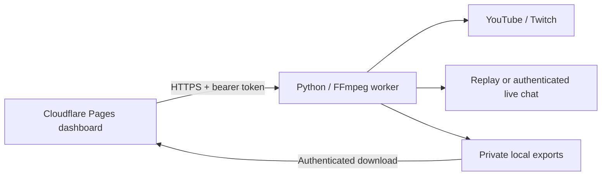

# Clipforge Studio

**Turn YouTube and Twitch recordings into reviewed vertical clips, with chat-spike evidence and purposeful layouts.**

A lightweight Python/FFmpeg worker and dependency-free web dashboard. Designed for a small operator preparing batches of gameplay content—not a promise of automatic virality, monetization, or fully autonomous editing.

## Features

- **Four layouts:** full gameplay with blurred background; vertical center crop; streamer on top/gameplay below; gameplay above a product image or looping product video.
- **Explicit crop controls:** choose the facecam and gameplay regions as percentages of the original frame. No unreliable claim that a fixed rectangle is automatic face detection.
- **Chat-driven selection:** timestamped message density, a rolling baseline, author spam caps, reaction-delay compensation, and non-overlapping clips. Each result explains why it was selected.
- **Three selection modes:** Chat only; Auto (chat preferred, activity fallback disclosed); Activity (motion/audio).
- **YouTube chat replay:** downloads replay when a completed stream exposes it. Ordinary videos may have no replay.
- **YouTube and Twitch live capture:** record the next 60–600 seconds while a configured chat reader collects messages. Output is generated after the window closes. This is bounded monitoring, not a continuous all-day service.
- **Text editing:** custom opening hook, product title, and call to action. Blank opening hooks use neutral templates.
- **Exports:** 10–30 seconds, 1–20 distinct moments per job, 1080 × 1920 H.264/AAC MP4, audio normalization, individual downloads, ZIP bundles, and a JSON manifest.
- **Durable job history:** persisted jobs survive restarts; interrupted jobs are marked clearly. Queue limit and cancellation keep work bounded.
- **Remote worker support:** explicit frontend origins and bearer-token authentication. Tokens stay in browser session storage and are never placed in media URLs.

## Quick start

Requires **Python 3.10+** and **Node.js 22+** for current YouTube challenges. FFmpeg is supplied by `imageio-ffmpeg` unless a system executable or `FFMPEG_BINARY` is configured.

```bash
python3 -m venv .venv
.venv/bin/python -m pip install -r requirements.txt
.venv/bin/python app.py
```

Open **http://127.0.0.1:8765**. On Windows use `.venv\Scripts\python.exe` in place of `.venv/bin/python`.

If your system Node is older, install a project-local runtime:

```bash
npm install --prefix runtime node@22
```

For the original workspace installation, run from the parent folder:

```bash
.clipforge-venv/bin/python clipforge/app.py
```

### First job

1. Paste a YouTube recording/live URL or a Twitch channel/VOD URL.
2. Choose Recording or Live monitor. A live job captures a future window; it cannot recover moments that passed before monitoring started.
3. Choose a layout. For Streamer split, set the facecam crop to its actual position in your source. For Product split, upload a JPG/PNG/WebP or MP4/WebM asset.
4. Choose Auto, Chat only, or Activity. Attach a timestamped chat JSON/JSONL file for recordings if needed.
5. Edit the hook/product text, clip duration, count, pre-roll and reaction delay.
6. Generate, review the evidence and framing, and download the clips or ZIP.

## Source support and honest limits

| Source | Video | Chat |
| --- | --- | --- |
| Completed YouTube stream | Supported when downloadable | Automatic replay when exposed by YouTube; otherwise upload timed chat |
| Ordinary YouTube video/Short | Supported when downloadable | Often no chat; Auto explicitly falls back to activity |
| Active YouTube broadcast | Bounded capture | Requires worker-side YouTube API credentials and accessible active chat |
| Twitch VOD | Supported when downloadable | Upload a timestamped Twitch comments export or normalized chat JSON |
| Active Twitch channel | Bounded capture | Requires worker-side Twitch read-chat token/login |
| Local recording | CLI | Optional chat export |

Recordings are limited to four hours; downloader file limit is 2 GB per file. Separate high-quality video/audio streams may require additional temporary disk space. Live capture is limited to ten minutes per job. HLS/network latency makes live chat-to-video timing approximate; adjust reaction delay after reviewing your source. A chat spike is an engagement signal, not proof of a good story. Three effective messages in five seconds is the minimum qualifying bin. Chat-only fails rather than silently substituting activity. Auto warns when it falls back. Quiet sources can yield fewer clips than requested.

The application does not identify whether footage is actually GTA VI, understand every joke, automatically transcribe subtitles, train a neural model, or predict virality. Opening hooks are templates or user-supplied. Product video audio is muted; source audio is retained. Facecam cropping is manual. Use clear product text that matches the uploaded asset.

## Chat formats

YouTube's native `live_chat` JSONL replay is supported. Only actual message additions are counted; replay offsets are read from `replayChatItemAction.videoOffsetTimeMsec`, not absolute epoch timestamps. Twitch exports with `comments[].content_offset_seconds` are supported.

A simple normalized export works for either platform:

```json
[
  {"time": 62.4, "author": "anonymous-viewer-1", "id": "optional-unique-id"},
  {"time": 62.8, "author": "anonymous-viewer-2", "id": "another-id"}
]
```

`time` is seconds from the **start of the supplied recording**. If you trimmed a recording, shift chat timestamps by the same amount. Duplicate message IDs are removed. An author contributes at most three messages per five-second bin. Exports without author identifiers cannot receive the same spam protection. Live collectors save anonymized author identifiers and message timing, not message bodies. Native downloaded replay files may contain public chat text; treat exports as private working data and delete them when no longer needed.

## Live chat credentials

Copy `.env.example` to `.env` and set only what you use. `.env` is loaded literally on worker startup; it is excluded from Git and Docker context.

- **YouTube:** enable YouTube Data API v3 and set `YOUTUBE_API_KEY`. Set `YOUTUBE_ACCESS_TOKEN` if your API operation requires OAuth. Quota, API permissions, disabled chat and token expiry can block collection. This app does not manage Google OAuth or refresh tokens. It honors `pollingIntervalMillis`.
- **Twitch:** set `TWITCH_CHAT_LOGIN` and `TWITCH_CHAT_TOKEN` for the same user, with `chat:read`. The read-only IRC connector uses TLS; it joins and responds to protocol pings, but sends no public chat messages. Token acquisition/refresh is external. Twitch recommends EventSub for new full-featured chatbots; this bounded reader uses the documented IRC interface.
- **No credentials:** recordings can use uploaded chat; live Auto can record and disclose an activity fallback. Strict live Chat mode fails before recording when no chat connection can be established.

Never enter platform credentials into the public frontend or commit them. The dashboard's Settings token is the **Clipforge worker access token**, not a Twitch/YouTube credential.

## Hosting: free frontend, separate video worker

**Recommended: Cloudflare Pages for the static dashboard, plus this Python worker on your own computer.** Netlify is also configured. Neither static host runs this Python/FFmpeg pipeline. Publishing the dashboard alone does not create a working cloud renderer.



Cloudflare Workers Free has a 10 ms CPU budget per HTTP request. Netlify functions have a 60-second synchronous / 15-minute background limit and small payload limits. These are poor fits for downloading and rendering long gameplay recordings. A local worker avoids a recurring server subscription but uses your computer, bandwidth, storage, and electricity, and must stay online.

### Build the dashboard

```bash
python3 scripts/build_frontend.py
```

The `dist/` folder is the complete static deployment artifact. No Node build or frontend dependency install is needed.

### Cloudflare Pages

1. Push this repository to GitHub (exclude exports, runtime, `.env`, and credentials).
2. In Cloudflare Workers & Pages, create a Pages project connected to the repository.
3. Build command: `python3 scripts/build_frontend.py`; output directory: `dist`; no framework preset.
4. Deploy and note the actual `https://<project>.pages.dev` URL.
5. Configure the worker's `.env` with a long random `CLIPFORGE_API_TOKEN` and that exact origin in `CLIPFORGE_ALLOWED_ORIGINS`.
6. Expose only the authenticated worker through an HTTPS tunnel or suitable container host. A local-only worker at `127.0.0.1` is not reachable from another user's device.
7. Open dashboard Settings and enter the HTTPS worker URL and worker token. Check connection before starting jobs.

For an already authenticated Wrangler installation:

```bash
npx wrangler pages deploy dist --project-name clipforge-studio
```

This needs an existing Pages project and account authorization; it is not executed by the build script.

### Netlify alternative

Import the same GitHub repository; `netlify.toml` supplies the build command and `dist` output. Configure the worker origin and dashboard Settings exactly as above. No heavy FFmpeg Netlify function is included.

### Remote worker / Docker

Set a long random `CLIPFORGE_API_TOKEN` and explicit `CLIPFORGE_ALLOWED_ORIGINS`, then run:

```bash
.venv/bin/python app.py --host 0.0.0.0 --port 8765
```

With a configured token, even local API calls require authentication. The server refuses a non-loopback bind without an explicitly configured token. Use HTTPS for remote connections; keep port 8765 private when using a tunnel. The optional `CLIPFORGE_ALLOWED_HOSTS` only controls serving dashboard files directly from the worker. It does not replace authentication.

A Dockerfile is included for a separate worker host:

```bash
docker build -t clipforge-studio .
docker run --rm --env-file .env -p 127.0.0.1:8765:8765 -v clipforge-data:/data clipforge-studio
```

Docker configuration is provided; building it requires Docker and network access. Static-host billing/free quotas and tunnel availability remain subject to the provider's current plan.

## CLI

```bash
.venv/bin/python bot.py 'https://www.youtube.com/watch?v=VIDEO_ID' --selection auto --count 3 --length 12 --layout streamer --output exports/my-clips
.venv/bin/python bot.py '/path/to/gameplay.mp4' --selection chat --chat '/path/to/chat.json' --layout product --ad-asset '/path/to/product.png'
.venv/bin/python bot.py 'https://www.twitch.tv/CHANNEL' --mode live --live-seconds 120 --selection chat
```

For custom crop rectangles and ad text use the dashboard or `create_clips()` Python interface. CLI live credentials must be exported into the shell environment; `.env` loading belongs to the web worker entry point.

## API

| Method | Path | Purpose |
| --- | --- | --- |
| GET | `/api/health` | Version, chat capabilities, authorization requirement |
| GET | `/api/jobs` | Recent jobs |
| POST | `/api/assets` | Binary asset upload; `X-Filename` header; max 200 MB (chat 20 MB) |
| POST | `/api/jobs` | Validate and queue a job |
| GET | `/api/jobs/<id>` | Status, warnings and manifest |
| POST | `/api/jobs/<id>/cancel` | Cancel queued/running work; body `{}` |
| GET | `/api/jobs/<id>/bundle` | ZIP of finished clips and manifest |
| GET | `/exports/<id>/<clip>` | Authenticated MP4 download |

Remote API requests use `Authorization: Bearer <worker-token>`. Media is fetched with authorization into browser blob URLs; credentials never appear in download query strings. The service is a single-operator tool, not a multi-tenant SaaS: one worker token can access all jobs. Add per-user authorization, storage isolation and abuse controls before selling public tool access.

## Development and verification

```bash
.venv/bin/python -m unittest discover -s tests -v
python3 scripts/build_frontend.py
```

Tests use generated footage and timestamped chat fixtures, including layout pixels, audio/duration, spike alignment, spam caps, replay deduplication, cancellation and input rejection. Live connectors require real platform credentials and an active broadcast; deterministic fixture tests do not prove live network availability. GitHub Actions runs tests and the static build on pushes and pull requests. No deployment secrets are required for CI.

## Repository map

```text
app.py                 HTTP API, authentication, uploads, persistent jobs
bot.py                 source acquisition, scoring and FFmpeg layouts
chat.py                replay parsing and density-based spike selection
live.py                bounded YouTube API / Twitch IRC collectors
static/                deployable browser dashboard assets
scripts/build_frontend.py
requirements.txt
.env.example
wrangler.jsonc         Cloudflare Pages output configuration
netlify.toml           alternative static hosting configuration
Dockerfile             separate video worker
.github/workflows/ci.yml
```

Use footage, streamer likeness, product media, and music that you have appropriate rights to process and distribute. Software access and downloading a public URL do not grant resale rights or platform monetization eligibility. MIT applies to the software; media has its own rights.

## Primary references

- [yt-dlp](https://github.com/yt-dlp/yt-dlp)
- [YouTube live chat API](https://developers.google.com/youtube/v3/live/docs/liveChatMessages/list)
- [Twitch IRC](https://dev.twitch.tv/docs/chat/irc)
- [Cloudflare Workers limits](https://developers.cloudflare.com/workers/platform/limits/)
- [Netlify function limits](https://docs.netlify.com/build/functions/configuration/)
