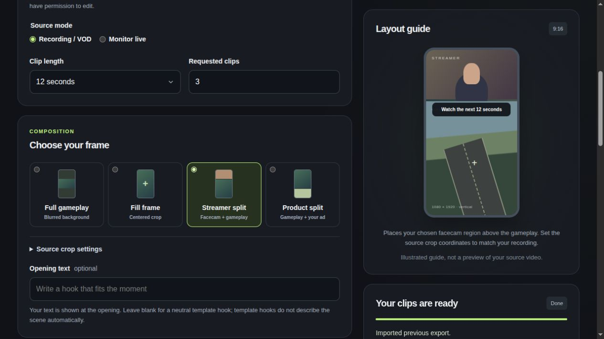
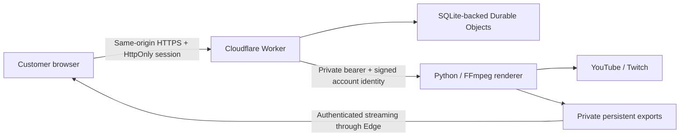

<div align="center">

# Clipforge Studio

### Find the moment. Frame the story. Caption the words.

YouTube & Twitch clips · Private accounts · Speech captions · Vertical layouts


[Open Studio](https://clipforge-studio.abdullahsiham31602.workers.dev/) · [Customer flow](#customer-flow) · [Architecture](#architecture) · [Deployment](#operator-deployment) · [Verification](#verification)

</div>

Clipforge creates short vertical clips from YouTube and Twitch sources. Customers create an account, paste a link, choose a composition and captions, then review and download their own exports. There is no customer-facing worker URL, shared access token, connection-file import or developer settings screen.



 > **Repository contents:** this public repository currently provides project documentation. The complete application source is distributed separately; the live customer app is linked above.

## Customer flow

1. Choose **Create account**, then choose a username and a password of at least 12 characters.
2. Download and privately save the recovery key shown after signup. This version has no email reset: losing both the password and recovery key makes the account unrecoverable.
3. Paste a public YouTube recording/live link or Twitch channel/VOD link you have permission to process.
4. Choose 1–3 clips, 10/12/15 seconds, composition, opening hook and optional speech captions.
5. Generate, review the selection evidence and framing, then download MP4, SRT or a ZIP bundle.

Sign-in uses a Secure, HttpOnly, SameSite cookie valid for seven days. It works across tabs in the same browser; a separate browser signs in with the same username and password. Worker secrets never reach browser JavaScript. There is no claim that clipping guarantees virality or income.

## Included features

| Area | Behavior |
| --- | --- |
| Accounts | Username/password signup and login, logout, one-time recovery keys, password reset with session invalidation |
| Privacy | Signed server-to-renderer identity; account isolation for jobs, cancellation, uploads, clips and bundles |
| Daily allowance | 3 clips per account per UTC day; concurrent reservations are atomic; failed/cancelled and undelivered clips are refunded when checked |
| Abuse controls | Signup/login/request limits, 50 MB per upload, 100 MB uploaded per account per UTC day, a bounded global render queue |
| Sources | YouTube recordings, YouTube/Twitch bounded live captures, Twitch VODs; subject to download availability |
| Compositions | Blurred-background gameplay, center crop, streamer above gameplay, gameplay above a product image/video |
| Captions | Local faster-whisper recognition, active-word or phrase styling, SRT and timed JSON |
| Editing | Editable opening hook and product CTA, optional gentle punch-in accents |
| Selection | Chat-spike ranking where timed chat exists; motion/audio fallback disclosed; strict Chat mode fails without qualifying chat |
| Exports | 1080 × 1920 H.264/AAC, private streaming previews, MP4/SRT/ZIP downloads |
| Retention | Customer exports removed after seven days during hourly maintenance; source downloads removed after a customer job ends; uploads expire after 24 hours |

Customer recordings are limited to 60 minutes, live captures to two minutes and an executing job to 20 minutes. One renderer processes one job at a time, with at most three queued/running jobs. The operator CLI retains broader limits. The quota is a trial allowance, not billing: paid plans, payment collection and administrative subscription management are not implemented.

## Architecture



Cloudflare hosts the dashboard, accounts, sessions, quotas and authenticated API gateway. A separate Python process performs downloading, analysis, transcription and rendering. Durable Objects use the SQLite backend supported on the Workers Free plan. No browser needs to know the renderer address.

**Current operating boundary:** the renderer still runs on the operator's computer through a temporary Cloudflare Tunnel. The computer, internet connection and tunnel must remain available. This deployment has no 24/7 rendering SLA. Cloud compute, a stable renderer hostname and persistent media backups must be selected before promising an always-on commercial service. Hosting the dashboard does not supply FFmpeg compute. Cloud billing and free-tier quotas remain subject to provider limits.

## Operator deployment

### 1. Prepare the renderer

Python 3.10+ and Node 22+ are required. FFmpeg is provided by `imageio-ffmpeg`, or set `FFMPEG_BINARY`.

```bash
python3 -m venv .venv
.venv/bin/python -m pip install -r requirements-ai.txt
cp .env.example .env
```

Set a random 32+ character `CLIPFORGE_API_TOKEN` and the exact website origin in `CLIPFORGE_ALLOWED_ORIGINS`. Store `.env` privately and outside source control. Platform tokens, if used, stay on this renderer.

```bash
.venv/bin/python scripts/prepare_captions.py
.venv/bin/python app.py
```

The base speech model is downloaded once. Caption audio is processed locally on the renderer. `CLIPFORGE_WHISPER_MODEL` accepts `tiny`, `base`, or `small`; `CLIPFORGE_MODEL_CACHE` controls the model directory.

The Python HTTP API is an internal operator service. Its static page alone does not implement account APIs; customers use the Cloudflare website. Expose the renderer only through HTTPS and keep its port private. Requests bearing only the operator token are administrative; customer requests require an additional expiring HMAC identity generated by the gateway. Do not distribute the operator token or legacy connection profiles.

### 2. Build and publish the Cloudflare application

```bash
npm install --prefix runtime node@22 wrangler@4
python3 scripts/build_frontend.py
runtime/node_modules/node/bin/node runtime/node_modules/wrangler/bin/wrangler.js login
runtime/node_modules/node/bin/node runtime/node_modules/wrangler/bin/wrangler.js deploy --config wrangler-worker.jsonc --keep-vars
```

`wrangler-worker.jsonc` declares the account Durable Object binding and its SQLite migration. It routes `/api/*` and `/exports/*` through the Worker before assets. Preserve the same Worker, binding name and migration history on upgrades. Do not delete the account namespace during redeployment.

Configure these **Cloudflare server secrets**, through secret prompts or `wrangler secret bulk` on stdin:

| Secret | Value |
| --- | --- |
| `AUTH_PEPPER` | A generated high-entropy password/recovery pepper; retain a secure backup |
| `RENDERER_URL` | HTTPS origin of the renderer, without a path or credentials |
| `RENDERER_TOKEN` | The renderer's `CLIPFORGE_API_TOKEN` |

After initial deployment, verify all three names with `wrangler secret list --config wrangler-worker.jsonc`. If deploying over a previous assets-only Worker, set secrets again after the script exists. Use `--keep-vars` for later deployments. Never place these secrets in `vars`, frontend config, command-line argument values, screenshots or public Git files. A tunnel-address change requires updating only the server-side `RENDERER_URL` secret, never customer Settings.

Accounts store a salted PBKDF2-SHA512 password verifier (100,000 iterations) additionally protected by the server-side HMAC pepper; passwords are never stored. Sessions store only hashes of random 256-bit cookie secrets. Password recovery rotates both the recovery key and account session version. Rate limits are backed by Durable Objects. Have the authentication and operational design independently reviewed before a broad commercial launch; it is not externally audited.

### 3. Container deployment option

```bash
docker build -t clipforge-studio .
docker run --rm --env-file .env -p 127.0.0.1:8765:8765 -v clipforge-data:/data clipforge-studio
```

The image includes the speech engine, runs as a non-root user and stores media/models in `/data`. Warm the model and verify inference on the chosen CPU host before accepting traffic. This configuration is supplied; Docker is not installed in the current workspace, so the image build has not been executed here.

### 4. Operations before selling access

- Move the renderer to persistent compute with sufficient CPU, memory and disk; retain HTTPS and the exact allowed origin.
- Back up both account state and `AUTH_PEPPER`; protect the operator token and persistent media separately. Recovery keys cannot replace operator backups.
- Configure uptime/error monitoring, disk alerts, documented recovery and capacity testing on the actual host.
- Choose an entitlement/payment provider and implement paid plans before advertising subscriptions. The current trial grants three daily clips to registered accounts.
- Configure live-chat credentials and test real broadcasts if selling live-chat selection. Fixture tests alone do not prove platform API access.

## Selection and media limits

Chat bins use five-second intervals, author spam caps and a rolling baseline; timestamps can be offset for reaction delay. Completed YouTube broadcasts may expose native replay; ordinary videos often do not. Twitch VOD chat can be supplied as a timed export. Live YouTube collection needs YouTube API access; Twitch uses a read-only TLS IRC connection with `chat:read`.

Normalized replay format:

```json
[{"time":62.4,"author":"viewer-1","id":"message-1"}]
```

`time` is seconds from the supplied recording's beginning. Historical replay cannot align with a newly started live capture. HLS latency makes live timing approximate. Quiet sources may produce fewer clips than requested.

Captions transcribe mixed source audio and may include game dialogue. Speakers are not separated; language detection is not translation. Review slang, names and overlapping voices. Framing is manual; there is no automatic face detection or semantic virality prediction. Hooks are templates or user-supplied. Product audio is muted and source audio retained. Use media, music, streamer likenesses and product assets you have rights to process and distribute.

## Verification

```bash
.venv/bin/python -m unittest discover -s tests -v
node tests/test_gateway.mjs
python3 scripts/build_frontend.py
```

The current automated run passed **22 Python tests** and **7 gateway tests**, covering real FFmpeg renders, captions, chat timing, cancellation, HTTP ranges, cross-account jobs/assets/exports, forged identities, cookie attributes, CSRF, recovery, quota concurrency and refunds, and authentication rate limits. The public artifact test rejects operator secrets/renderer addresses in the frontend. Gateway tests use a storage fixture; live browser validation additionally checks the deployed Cloudflare account runtime and customer requests. Docker and active platform-chat connectors require separate environment-specific checks.

## Repository map

```text
edge/worker.mjs             accounts, sessions, recovery, quotas, private API gateway
app.py                     internal rendering API, tenant authorization, retention
bot.py                     downloads, ranking, compositions and FFmpeg output
captions.py                local speech transcription, safe ASS/SRT output
chat.py / live.py           timed replay parsing and bounded live collectors
static/                    customer dashboard and account UI
scripts/build_frontend.py   same-origin frontend artifact; no public server secrets
wrangler-worker.jsonc      full customer Cloudflare application + SQLite accounts
Dockerfile                 separate non-root caption-enabled renderer
.env.example               operator configuration template only
.github/workflows/ci.yml    video, security and gateway checks
```

The older `wrangler.jsonc` and `netlify.toml` describe static-only deployment and do not supply customer accounts. Use `wrangler-worker.jsonc` for this product. Software licensing is left to the repository owner; media rights are separate.

## Primary documentation

- [Cloudflare static asset routing](https://developers.cloudflare.com/workers/static-assets/binding/)
- [Durable Object SQLite storage and migrations](https://developers.cloudflare.com/durable-objects/reference/durable-objects-migrations/)
- [Durable Objects pricing and free limits](https://developers.cloudflare.com/durable-objects/platform/pricing/)
- [Cloudflare Web Crypto](https://developers.cloudflare.com/workers/runtime-apis/web-crypto/)
- [yt-dlp](https://github.com/yt-dlp/yt-dlp)
- [YouTube live chat API](https://developers.google.com/youtube/v3/live/docs/liveChatMessages/list)
- [Twitch chat](https://dev.twitch.tv/docs/chat/)
